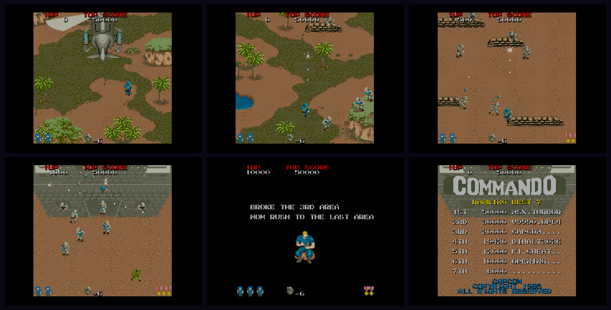

# Commando for MSX turbo R + V9990

**Capcom's 1985 vertical run-and-gun arcade game adapted to the MSX turbo R.**

An unofficial homage port by **DiHalt Studio**, 2026.



## Play it

Version 1.0 comes as a **2 MiB ASCII16 MegaROM**. Use an MSX turbo R, a V9990 graphics cartridge and a flash cartridge that supports ASCII16. Connect audio to a MoonSound or Wozblaster for FM music and PCM effects. The first startup messages appear on the MSX video output. The game appears on the V9990 output. [Download v1.0](https://github.com/DiHaltStudio/commando-v9990/releases/tag/v1.0).

- [English user manual](docs/manual/manual-en.pdf)
- [Manual en español](docs/manual/manual-es.pdf)

Both manuals include a printable cartridge label.

Extract the release archive and run the ROM in openMSX:

```sh
openmsx -machine Panasonic_FS-A1ST -ext gfx9000 -ext moonsound \
  -cart commando_v9990.rom -romtype ASCII16 \
  -command 'after time 1 {set videosource GFX9000}'
```

From a clone, put the ROM in `release/` and use `make run-st`.

| Action | Keyboard | Joystick 1 |
| --- | --- | --- |
| Move | Cursor keys | Directions |
| Fire the rifle | Space or Z | Button 1 |
| Throw a grenade | M or X | Button 2 |
| Start on normal | 1 or fire | Button 1 |
| Start on easy | 2 or grenade | Button 2 |
| Pause or resume | P | |

Guide Super Joe through eight battlefield areas. Use grenades against enemy positions and take on the fortress defenses. When you make the high-score table, shoot the characters you want in your name.

## What is this?

The port adapts the arcade program to the turbo R and draws the game in V9990 P1 mode. The audio driver plays the music through OPL FM and plays the effects as PCM on MoonSound and Wozblaster. It also supports PSG effects through the MSX audio output when PCM playback is unavailable.

## Building from source

```sh
git clone https://github.com/DiHaltStudio/commando-v9990.git
cd commando-v9990
python3 -m venv build/venv
build/venv/bin/pip install -r requirements-build.txt
make PY=build/venv/bin/python ARCADE_ROMS=/path/to/your/commando
```

Place the v1.0 MSX ROM in `release/` before building. The builder reads its cover picture and reads the arcade program, sound data and graphics from your local **Commando (World)** dumps. You can also supply your own local cover image to build without the downloaded MSX ROM. See the file list and tools in [Building from source](docs/BUILDING.md).

## Repository layout

| Path | Contents |
| --- | --- |
| [src/](src/) | Z80 code for the cartridge, V9990 renderer and audio |
| [assets/](assets/) | DiHalt Studio branding and build data |
| [tools/](tools/) | Build tools, converters and openMSX capture scripts |
| [docs/DESIGN.md](docs/DESIGN.md) | Cartridge, video and audio design |
| [docs/manual/](docs/manual/) | English and Spanish manuals with LaTeX sources |

## Make it better

**Please improve the game if you feel so!** Contributions could improve the V9990 renderer, refine the OPL instruments or make the asset tools easier to use.

## Credits and rights

Original arcade game by **Capcom, 1985**. MSX adaptation by **DiHalt Studio, 2026**. The game, artwork, music, logos and trademarks belong to their respective rights holders. This unofficial port is a tribute made for study and preservation. It has no affiliation with Capcom.
